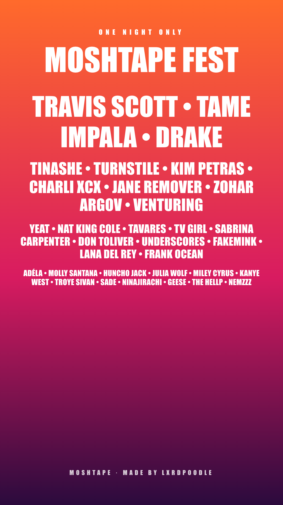

# Moshtape

Moshtape turns your Spotify listening into a festival lineup poster. You log in, pick a time range, decide how many days your festival runs, and download the poster. The idea comes from Receiptify, which does the same kind of thing with a receipt.

Live site: [moshtape.vercel.app](moshtape.vercel.app) 



## What it does

- Logs you in with Spotify (read-only access to your top artists, nothing gets stored)
- Lets you pick a time range: last 4 weeks, last 6 months, or all time
- Builds a 1, 2, or 3 day festival. With more than one day, your top artists headline one day each and the rest are spread across the days
- Lets you set a festival name, a location, and a start date, and labels each day for you
- Has four poster themes (Sunset, Neon, Desert, Mono)
- Downloads the poster as a 1080x1920 PNG, which is the size of an Instagram Story

## Running it on your own computer

You'll need Node.js installed.

1. Clone the repo and install the packages:

   ```
   git clone https://github.com/YOUR-USERNAME/moshtape.git
   cd moshtape
   npm install
   ```

2. Create a Spotify app at [developer.spotify.com/dashboard](https://developer.spotify.com/dashboard). Set the redirect URI to `http://127.0.0.1:5173/callback` and choose Web API.

3. Make a file called `.env` in the project folder and add your Client ID:

   ```
   VITE_SPOTIFY_CLIENT_ID=your_client_id_here
   ```

4. Start it:

   ```
   npm run dev -- --host 127.0.0.1
   ```

5. Open `http://127.0.0.1:5173` in your browser. Use that address, not `localhost`, or Spotify login won't work.

## Spotify setup problems I ran into

These cost me a while, so here they are in case they help someone else.

- **Use `127.0.0.1`, not `localhost`.** Spotify rejects `localhost` as a redirect for new apps.
- **The account that owns the Spotify app needs Premium.** Without it, requests fail with an "Active premium subscription required" message. Spotify changes these rules now and then, so check their current docs.
- **Everyone who logs in has to be on the app's user list.** While an app is in development mode, only people added under User Management (name plus the exact email on their Spotify account) can log in. Anyone else gets a 403 error saying the user may not be registered.
- **Restart the dev server after editing `.env`.** Vite only reads it when it starts.

## How the multi-day lineup works

For a festival with more than one day, artist number 1 headlines day 1, number 2 headlines day 2, and so on. The remaining artists are dealt out to the days one at a time in rank order, so each day ends up with a mix of bigger and smaller names. Then each day's acts are grouped into rows by size.

## Deploying

I host it on Vercel, which rebuilds the site every time I push to GitHub.

1. Import the repo into Vercel.
2. Add `VITE_SPOTIFY_CLIENT_ID` as an environment variable.
3. After the first deploy, add `https://your-site.vercel.app/callback` as a second redirect URI in the Spotify dashboard (keep the 127.0.0.1 one for local work).

The `vercel.json` file makes sure the `/callback` page loads the app after Spotify sends you back.

## Known issues

- A few layout problems are still on my list, mostly on the 3-day poster when artist names are very long.
- Because the Spotify app is in development mode, only people I've added can log in. Opening it up to everyone means applying to Spotify for extended access.

## Built with

React, Vite, the Spotify Web API (PKCE login), and html-to-image for the download. Hosted on Vercel.

I built this with Claude as a coding assistant. I decided what it should do, ran and tested everything, and worked through the bugs, and Claude wrote most of the code along the way.
